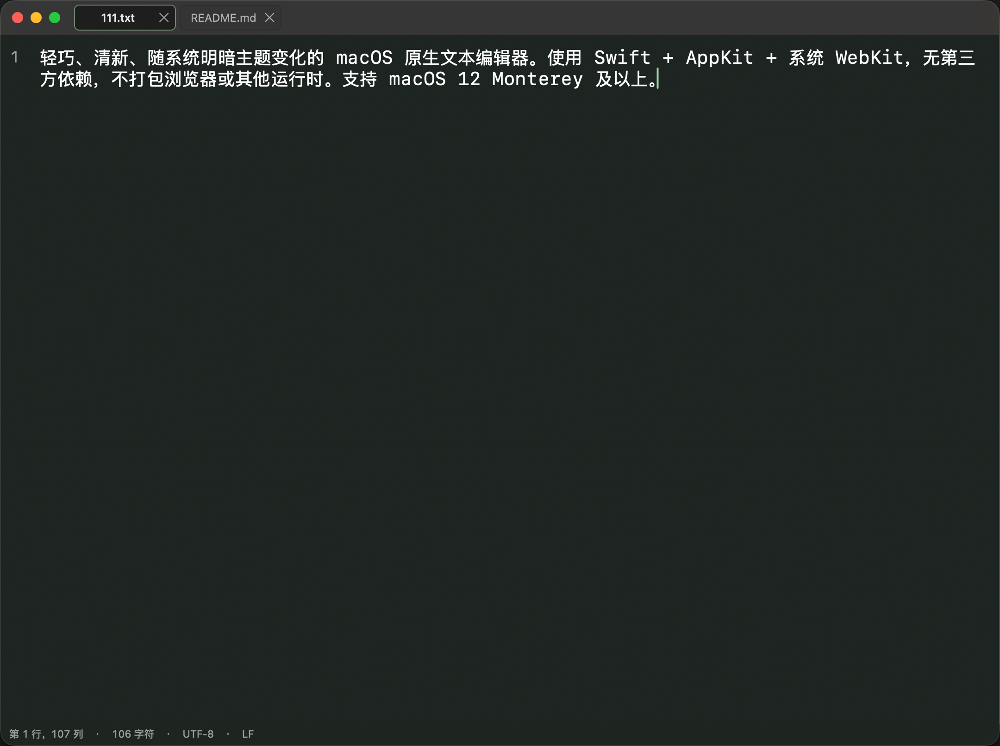
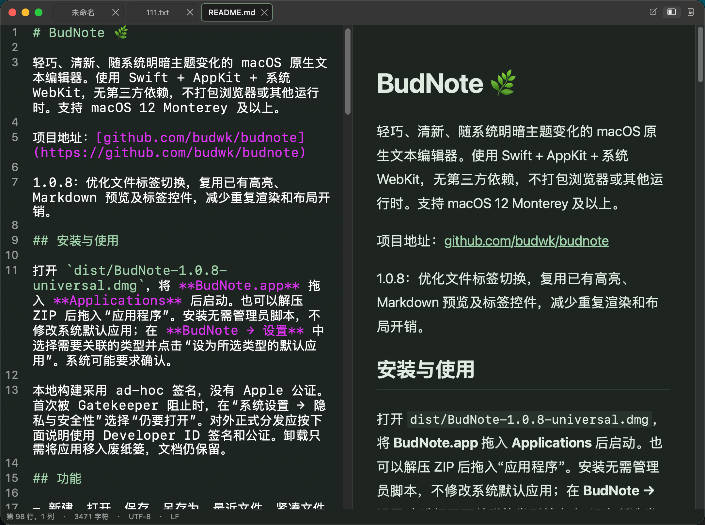

# BudNote 🌿

轻巧、清新、随系统明暗主题变化的 macOS 原生文本编辑器。使用 Swift + AppKit + 系统 WebKit，无第三方依赖，不打包浏览器或其他运行时。支持 macOS 12 Monterey 及以上。

项目地址：[github.com/budwk/budnote](https://github.com/budwk/budnote)

1.0.9：修复 Markdown 分栏编辑区滚动卡顿与回弹；右侧预览按源码行位置跟随左侧滚动。

## 界面

<p align="center">
  <a href="Resources/bn00.png"></a>
  <a href="Resources/bn01.png"></a>
</p>

## 安装与使用

打开 `dist/BudNote-1.0.9-universal.dmg`，将 **BudNote.app** 拖入 **Applications** 后启动。也可以解压 ZIP 后拖入“应用程序”。安装无需管理员脚本，不修改系统默认应用；在 **BudNote → 设置** 中选择需要关联的类型并点击“设为所选类型的默认应用”。系统可能要求确认。

本地构建采用 ad-hoc 签名，没有 Apple 公证。首次被 Gatekeeper 阻止时，在“系统设置 → 隐私与安全性”选择“仍要打开”。对外正式分发应按下面说明使用 Developer ID 签名和公证。卸载只需将应用移入废纸篓，文档仍保留。

## 功能

- 新建、打开、保存、另存为、最近文件、紧凑文件标签（支持关闭、横向滚动与快捷键切换）；支持 Finder 双击及拖放到 Dock 图标打开。
- 支持 txt、md、markdown、html、py、java、js、ts、json、css、xml、yaml、toml、log、sh、swift、C/C++ 等纯文本文件。
- Markdown 编辑、双栏实时预览（跟随编辑区滚动）、阅读模式；标题、段落、强调、删除线、列表、任务项、引用、代码围栏、表格、链接。
- HTML、Python、Java 及常见代码文件的关键词、字符串、注释、数字高亮。高亮仅影响显示，不会写入文件或干扰撤销。
- 跟随系统/浅色/深色主题，10–40 pt 等宽字体，自动换行、行号。偏好持久化并同步到所有窗口。
- 系统剪切/复制/纯文本粘贴、撤销/重做、增量查找/替换（包括全部替换）。
- UTF-8、带 BOM 的 UTF-16/32、GB18030；保留原编码、BOM、LF/CRLF/CR 换行。无法无损保存时报告错误，可手动转为 UTF-8。
- macOS NSDocument 自动保存、关闭未保存文档的提示及系统版本恢复；底部显示行列、字符数、编码和换行格式。

Markdown 预览实现常见语法子集，并非完整 CommonMark/GFM 实现；目前不支持嵌套列表、脚注、数学公式、图片渲染或原始 HTML 执行。HTML 文件以源码编辑。预览不加载外部脚本、样式或图片；只有主动点击链接时才打开系统浏览器。代码高亮采用轻量词法规则，不提供语言服务器或代码执行。超过一百万 UTF-16 字符的文件暂停高亮和预览，仍可编辑和保存；超大型日志建议使用专门工具。

## 快捷键

| 操作 | 快捷键 |
| --- | --- |
| 新建 / 打开 / 保存 | ⌘N / ⌘O / ⌘S |
| 另存为 | ⇧⌘S |
| 放大 / 缩小字体 | ⌘ + 鼠标滚轮上 / 下 |
| 撤销 / 重做 | ⌘Z / ⇧⌘Z |
| 查找 / 替换 | ⌘F / ⌥⌘F |
| 下一个 / 上一个结果 | ⌘G / ⇧⌘G |
| 编辑 / 实时预览 / 阅读 | ⌘1 / ⌘2 / ⌘3 |
| 换行 / 行号 | ⌥⌘W / ⌥⌘L |
| 增大 / 减小 / 重置字体 | ⌘+ / ⌘- / ⌘0 |
| 上一个 / 下一个文件标签 | ⇧⌃Tab / ⌃Tab |
| 设置 | ⌘, |

“文件 → 另存为…”（⇧⌘S）支持选择保存位置、名称、任意后缀和编码；默认保持原编码。“文件 → 移到…”选择目标文件夹，保存当前修改后保留文件名移动；目标已有同名文件时会提示重新选择。

新建文档默认为纯文本。可从“格式 → 作为 Markdown 编辑”开启 Markdown 模式，另存为 `.md`；已有文件按扩展名识别。“转换为 UTF-8”会标记文档为已修改，在下一次保存时生效。

## 编译

需要 Xcode 或包含 macOS SDK 的 Command Line Tools、Swift 5.9+、Python 3。Python 仅用于构建时生成 Info.plist，应用运行不需要 Python。

```bash
./build.sh                     # 当前架构，优化编译，生成 dist/BudNote.app
ARCH=universal ./build.sh       # Apple Silicon + Intel
CONFIGURATION=debug ./build.sh # 调试应用
open dist/BudNote.app
```

也可用 Xcode 打开 `Package.swift` 修改和编译。通过 `./build.sh` 生成完整的 `.app` 后运行；直接 `swift run` 没有文档类型配置，不能作为完整应用使用。

## 测试

```bash
./scripts/test.sh
```

运行核心单元测试及独立进程中的原生集成检查：编码逐字节往返、损坏数据拒绝、Markdown 渲染及安全转义、词法范围、NSDocument 打开/保存、真实 NSTextView 编辑和撤销重做、WebKit 预览及实时更新、首次分栏布局、编辑标签、查找替换及撤销、另存为编码和失败恢复、带未保存修改的移动、共享窗口的文档归属、连续切换后的窗口和工具栏稳定性、关闭当前标签、标签栏宽度和溢出滚动。集成检查只创建临时文档，不修改默认文件关联或用户文件。

## 发布

```bash
./scripts/release.sh                         # 默认 universal，生成 DMG、ZIP、SHA256
VERSION=1.0.9 ARCH=arm64 ./scripts/release.sh # 指定版本及架构
```

DMG 中包含应用、“应用程序”快捷方式及安装说明。默认应用注册使用官方 [NSWorkspace API](https://developer.apple.com/documentation/appkit/nsworkspace/setdefaultapplication(at:toopen:completion:))，失败时会显示原因，也可在 Finder“显示简介 → 打开方式 → 全部更改”设置。

正式签名及公证需要自己的 Apple Developer 账户及 Developer ID Application 证书：

```bash
# 一次性配置公证凭据（交互式输入，避免把密码放入脚本）
xcrun notarytool store-credentials "BudNoteNotary"

SIGN_IDENTITY="Developer ID Application: Your Name (TEAMID)" \
NOTARY_PROFILE="BudNoteNotary" VERSION=1.0.9 ./scripts/release.sh
```

脚本会启用 Hardened Runtime、提交 DMG 公证、给应用及 DMG 装订公证票据，再生成带票据的 ZIP 和校验和。设置 `NOTARY_PROFILE` 时必须提供 `SIGN_IDENTITY`。本仓库不会包含签名私钥、密码或公证凭据。

## 目录

- `Sources/BudNote`：原生紧凑标题栏、文件标签、编辑器、文档、设置和行号。
- `Sources/BudCore`：编码、Markdown 渲染、词法高亮规则。
- `Tests/BudCoreTests`：核心测试。
- `scripts`：构建、图标生成、测试及发布。
- `Examples/清晨笔记.md`：预览示例。
- `dist`：生成的应用及安装包（不提交 Git）。
